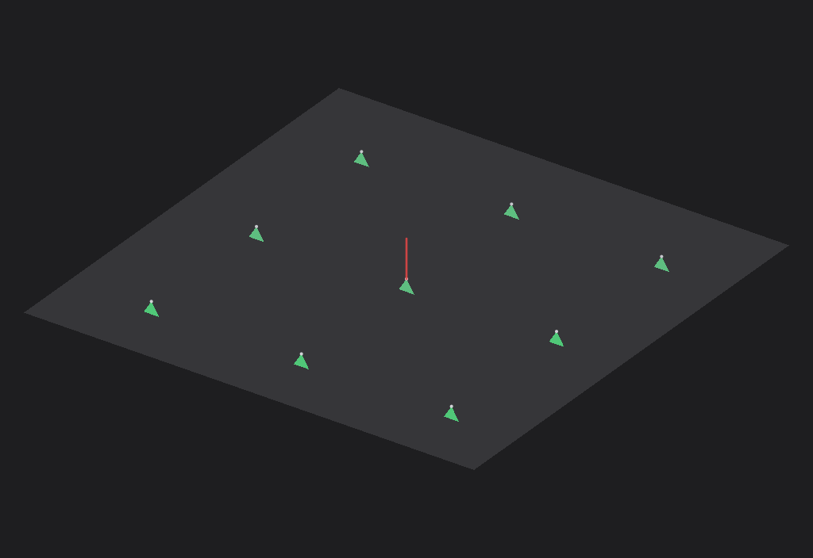
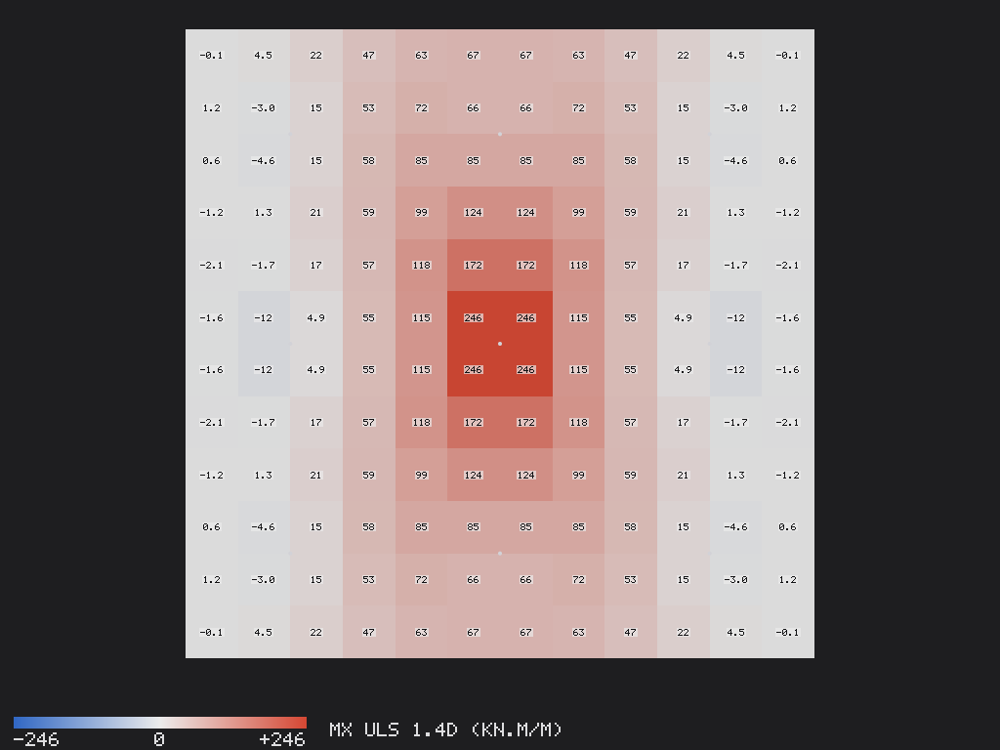
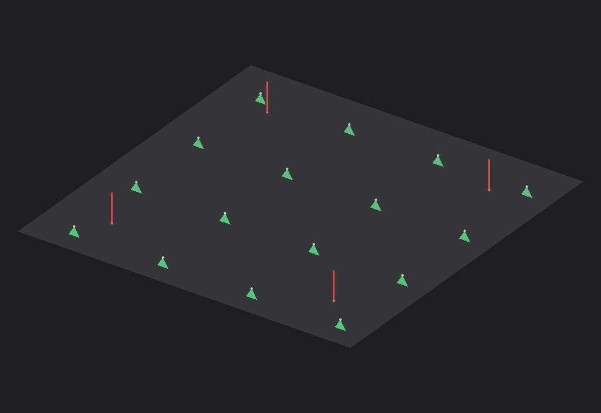
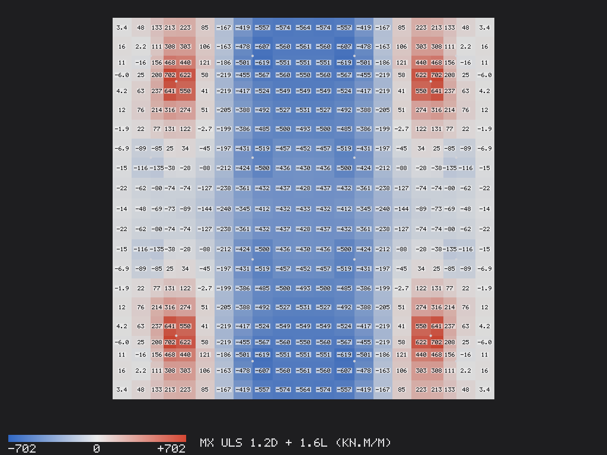
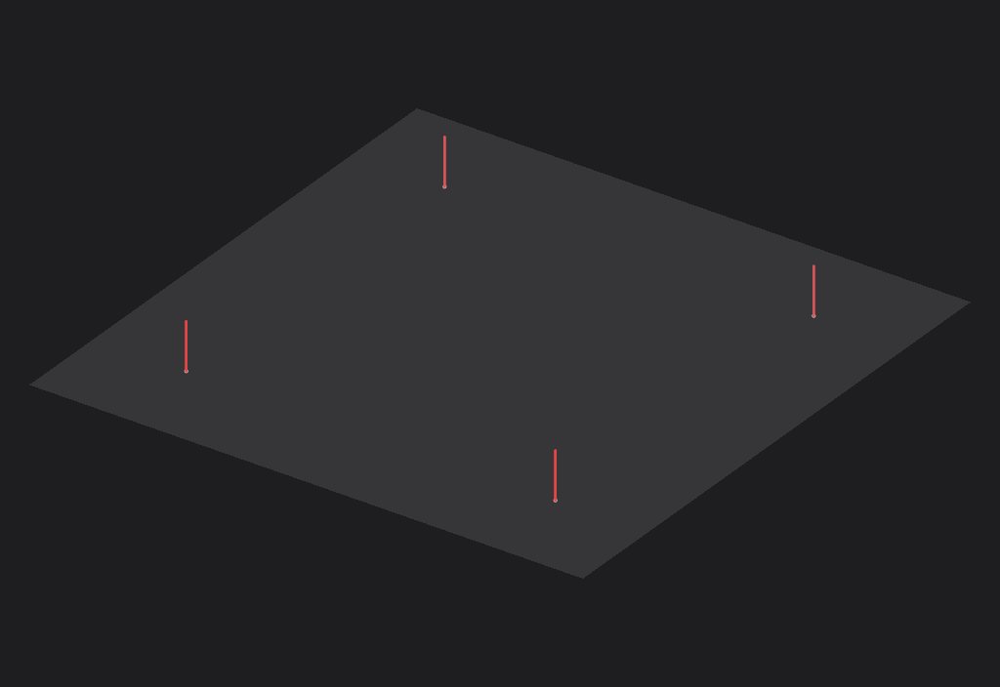
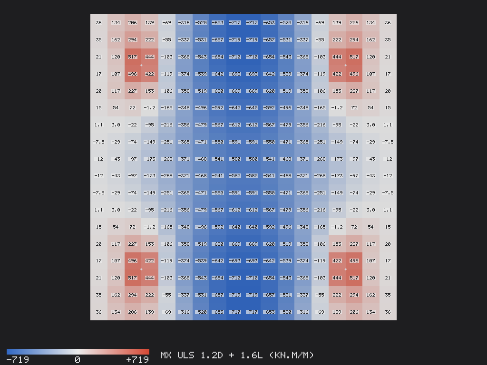

# Mat foundations on piles: a pile cap and a piled raft

Three foundation mats built in Pondus through its MCP server by `build_raft.py`, as an agent builds them with the `add_mat` tool, then analysed and designed. Each is a plate panel (MITC4 shell elements) resting on its supports with no beams: the piles are vertical springs of their axial stiffness EA/L, held in plan, and the raft of case C rests on a Winkler subgrade instead. The pile loads are the support reactions, the mat's moments per metre come from `get_slab_results`, and `design` gives the bars of both faces and the punching check at every pile and column load (ACI 318-19 22.6). Open any `.pondus` file in Pondus to look at the model, or read the four-page calculation report beside it.

| Case | Model | Mat | Supports | Loads |
|---|---|---|---|---|
| A | `nine_pile_cap.pondus` | 3.6 × 3.6 × 0.7 m | 9 piles at 1.2 m, 100,000 kN/m each, 0.3 m wide | 100 t (981 kN) dead at the centre |
| B | `piled_raft.pondus` | 9 × 9 × 1.2 m | 16 piles at 2.4 m, 150,000 kN/m each, 0.5 m wide | four 500 mm columns at (±3, ±3) m, 2,500 kN D + 800 kN L each |
| C | `raft_on_soil.pondus` | 9 × 9 × 1.2 m | Winkler subgrade 20,000 kN/m³, no piles | as B |

Concrete f′c 24 MPa, bars SD40, the mat's own weight in case D, combinations 1.4D, 1.2D + 1.6L and SLS D + L (the defaults of a new model). The mesh is a quarter of the pile spacing (0.3 m in A, 0.5 m in B and C). Run `python3 build_raft.py` to rebuild everything; it writes `results.md` with the numbers below.

## A. Nine-pile cap, 100 t at the centre

The reactions balance the applied 1,198.7 kN (981 kN plus the cap's 217.7 kN). The centre pile under the load takes 152.3 kN in service, the four side piles 133.7 kN and the four corner piles 127.9 kN, a spread of about ±14 % around the mean of 133.2 kN, because the 0.7 m cap is stiff against 1.2 m spans. The cap sags under the load, mx up to 175.6 kN·m/m in service and 245.9 kN·m/m under 1.4D, with slight hogging over the outer piles. Design: bottom bars DB16 @ 150 mm both ways (Mu 268 kN·m/m), top bars at the minimum, punching ratio 0.59 at the column load (Vu 1,373 kN on a 0.3 m square, bo 3.88 m, φVc 2,328 kN) and below 0.1 at each pile; the design ratio is 0.87, governed by flexure.

Had the piles been pinned instead of springs, the load placed right on the centre pile would have gone straight into it and the cap would not have bent at all, which is why `add_mat` asks for the pile stiffness. Corner piles carry more of the cap's own weight than the side piles: with 0.6 m overhangs the outer support rows of a continuous strip take more than the middle one (the three-moment equation gives 1.275 : 1.05 per row), and `core/tests/mat.rs` checks this.

## B. Piled raft under four columns

The applied dead load is 12,332.8 kN (10,000 kN from the columns and 2,332.8 kN of raft) and the reactions balance it. Under D + L the 16 piles take 911 to 1,042 kN each (mean 971 kN): the four corner piles the most, the four innermost the least, because each column stands between its four nearest piles. The raft spans from the columns to the piles in both directions, mx from −478 (hogging over the piles) to +542 kN·m/m (sagging under the columns) in service, and deflects 7.2 mm. Design: DB16 @ 75 mm on both faces both ways (Mu 805 kN·m/m bottom, 641 top), and punching governs at the columns with a ratio of 0.76 (Vu 4,280 kN under 1.2D + 1.6L, bo 6.68 m at d/2 round the 0.5 m column, φVc 5,629 kN); the piles are far below their punching capacity.

## C. The same raft on soil

With the piles replaced by a Winkler subgrade of 20,000 kN/m³ the soil takes the whole 15,532.8 kN (reported under node 0, the subgrade), the raft settles 10.5 mm at most under the columns, and its moments are mx −554 to +398 kN·m/m: hogging between the columns now exceeds the sagging under them, so the top bars govern the flexure (Mu 726 kN·m/m). Punching at the columns is the same 0.76 as in case B, since the column load and the slab are the same. The springs are linear, so there is no lift-off and no consolidation settlement; `support_size` 0.5 m stands for the column width in the punching check.

Structural results from any software must be checked by a qualified engineer before they are used for design or construction.
